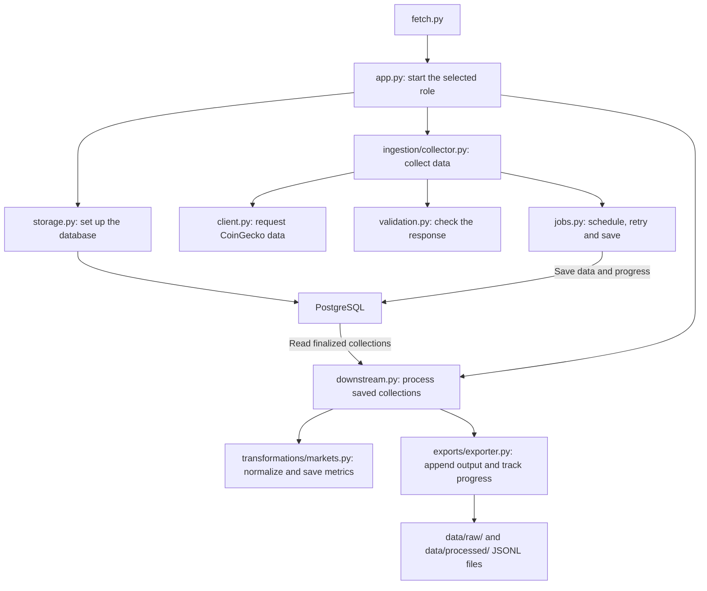
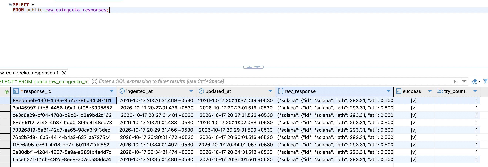
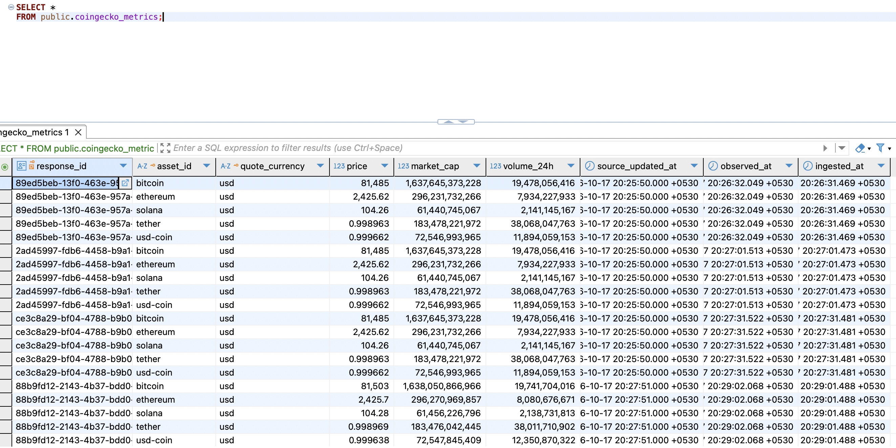
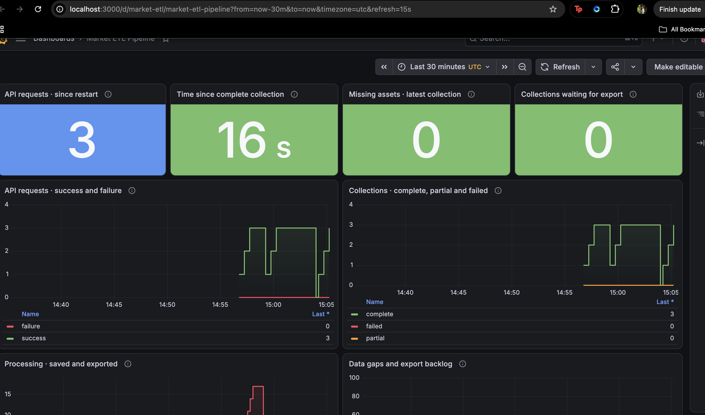

# How I designed the market-data pipeline

I built this pipeline to collect USD market snapshots for ETH, BTC, SOL, USDC
and USDT. It polls CoinGecko every 30 seconds, saves usable records in
PostgreSQL, normalizes them, and appends raw and processed collections to local
JSONL files. Logs and a Prometheus/Grafana setup show whether collection and
processing are working.

My main design question was: if one step fails, what have I already saved, and
what should the next attempt do? I wanted that answer to come from saved
progress, not from somebody remembering what happened in a terminal.

This document describes the current implementation first. Each production
section is a proposal, not a claim that those tools or guarantees are already
part of the submission. Python was approved by the recruiter even though the
assignment originally described Go.

## The mental model and ETL principles

I think of the system as two people working from the same notebook. The
collector writes down what it obtained from the source. The processor reads
finished collections and prepares the output. PostgreSQL is that shared
notebook: it stores the data and the progress needed to resume work.

The basic ETL responsibilities are extraction, transformation, loading into a destination  
and logging. I also need validation, clear record identities and recovery rules around  
those steps.

In this implementation:

- Extraction starts with the API request. Later, the processor also extracts
finalized collections from PostgreSQL for downstream work.
- Transformation turns source-shaped market records into a small set of typed,
flat observations with consistent timestamps.
- Loading finishes in `data/raw/` and `data/processed/`, as suggested by the  
assignment. PostgreSQL is also an intermediate durable store.

I would describe this as an ETL pipeline with an ELT-style intermediate stage.
Source records are loaded into PostgreSQL before final normalization, while
transformation happens before the processed file is loaded into local storage.
Calling every database write the final load would hide that distinction.

The principles I have applied throughout are:

1. Keep usable data when another record fails.
2. Give work a stable identity so retrying it does not create another copy.
3. Save progress at clear boundaries instead of assuming a whole run succeeded.
4. Keep source time, acquisition time and processing progress separate.
5. Make failures visible and state what recovery cannot fix.

## The current flow




This shows the main file connections, not every import. All Python paths except
`fetch.py` are inside `pipeline/`; `client.py`, `validation.py` and `jobs.py` are
inside its `ingestion/` folder.

`app.py` starts the collector or processor according to its command. Docker runs
them as separate containers. The collector saves source data in PostgreSQL; the
processor reads that saved data and calls the transformation and export functions.
For each collection, it exports raw data first, saves normalized metrics, then
exports processed data. It does not read the raw JSONL file for transformation.

Both roles also use `logging_setup.py` and `monitoring.py`. Those connections
are left out of this diagram to keep the main data path easy to follow.

PostgreSQL notifications wake the processor after a collection becomes complete
or partial. They are hints, not the work list. Startup and periodic scans of
saved rows find work even if a notification is missed. Failed collections with
no usable assets are not exported as market data.

## 1. Source selection and ingestion

### What I built and the principle behind it

Ingestion brings external data into a controlled pipeline. Its first job is to
make a bounded request and decide whether the returned data can be used.

I chose CoinGecko because its markets endpoint provides prices, market caps,
rolling 24-hour volumes and source update times for the five assets in one
request. This lets me demonstrate data-pipeline behaviour without introducing
blockchain node operation, transaction decoding or chain reorganizations.

`datahub` acts as a version controlled repository. `datahub/assets.json` holds the  
asset IDs and quote currency. `client.py` makes one HTTP request.  
`validation.py` checks the result. `collector.py` coordinates requests and  
`jobs.py` persists scheduling and retry decisions.

The collector reuses its HTTP session. It has connection and read timeouts,
and treats selected temporary HTTP/network failures as retryable. A successful
HTTP status is not enough: I also check the JSON structure, required price and
source timestamp. Optional market cap and volume can be null. 

### My choices and assumptions

A collection means one scheduled poll and its retries. It has one stable UUID.
It allows an initial request and at most two retries, admitted within 30 seconds
of its scheduled start. The usual retry wait is five seconds; a valid
`Retry-After` can require a longer wait and applies across later polling ticks.

There is one request path, so a scheduled poll and a retry cannot independently
send requests at the same time. Regular polling follows fixed 30-second ticks.
If a request starts at second 0 and finishes at second 45, I skip the missed
tick and wait for second 60. I do not wait until second 75 or send catch-up
requests for snapshots the API can no longer provide.

The read timeout is not a hard total request deadline. An already-running
request may finish after the collection window; its usable data is retained.
The 30-second window limits admission of another attempt.

I reserve each attempt before sending HTTP. Restarting cannot reset its budget,
but a crash between reservation and sending can consume an attempt without
making an actual request. This is a deliberate trade-off.

### Example: four good assets and one missing price

The first response contains four usable records and a fifth with no price. I
save the four and retry only the fifth. If the fifth arrives, it joins the same
collection with its own acquisition timestamp. If retries fail, the collection
finishes as partial and the four records remain available for export.

The next scheduled collection asks for all five assets again. A later current
price does not repair the earlier missing historical observation.

### What I left out and where I would extend it

I have not added streaming downloads, pagination, exponential backoff with
jitter, a provider-wide rate limiter, multiple providers or historical backfill.
The current source is latest-state data, and may return cached values.

I kept API fetching separate so another source like CoinMarketCap can be added later. 
Adding one would still require source-specific requests, validation and field mapping. 
The current scheduler supports only one dataset; multiple sources or currencies would 
need additional coordination changes.

For production I would first choose a provider plan that supports the required
cadence and freshness. The keyless API simplifies a short demonstration, but
CoinGecko explicitly says it is unsuitable for production or scheduled polling.
[CoinGecko keyless guidance](https://docs.coingecko.com/docs/keyless-public-api).
Continuous 30-second polling is 2,880 requests per day before retries.

I would then add a shared rate budget, capped backoff with jitter, provider
outage alerts and bounded request batches as the asset list grows. Retry
ownership would remain in one layer. A **Redis queue** or another broker would not
recreate historical prices; backfill needs a source that exposes those times.

## 2. Durable storage and record identity

### What I built and the principle behind it

Durable storage separates obtaining data from finishing all later steps. A
processor failure should not require another source request for data already
saved. **Idempotency** means retrying the same saved work has the same database
effect, rather than creating another observation.

PostgreSQL holds six tables:


| Table                     | What it remembers                                          |
| ------------------------- | ---------------------------------------------------------- |
| `collector_schedule`      | Next regular tick and provider cooldown                    |
| `collection_jobs`         | Collection identity, requested assets, attempts and status |
| `raw_coingecko_responses` | The assembled usable source records for a collection       |
| `coingecko_metrics`       | Typed normalized observations                              |
| `exported_collections`    | Which collections have been published to each output       |
| `export_checkpoints`      | How many bytes of each output file are confirmed           |


pipeline/storage.py defines all the database tables. The code that uses those tables stays 
with the relevant pipeline step: jobs.py saves and merges fetched data, markets.py 
saves and reads normalized data, and exporter.py tracks which collections have been 
exported and how much of each output file is confirmed.

### My choices and assumptions

All retries for one collection use the same `response_id`. A later scheduled
poll gets a new ID even if its prices and source timestamps are unchanged.
This preserves the history of what the collector observed on each poll.
Raw merges add newly usable assets, while existing assets win on conflicts.
Retrying a save cannot silently replace the first four records with later
prices.

The raw `success` field means at least one usable asset exists. It is not the
last HTTP call's status and does not mean all five assets were obtained. For
completeness I use the collection status and missing asset IDs. A later failed
retry therefore does not change four saved assets into a failed collection.

I run one collector and one processor. Each works sequentially with its own
database connection and ownership lock, so competing instances of the same
role cannot run together. Monitoring uses separate connections. Each attempt
also has an identifier that prevents an outdated result from changing work
that has already been recovered or reassigned.

This is a deliberate scope limit for the take-home: five assets do not need a
pool of parallel workers. Running more workers would require changes to job
ownership, claims and output writing. Recovery can also repeat an API request,
for example if the process crashes after receiving data but before saving it.
Stable collection IDs and merge rules prevent duplicate saved rows for the
same work; they do not guarantee that an external API request happens only once.

### Time has more than one meaning


| Field                   | Table and location                                                                                       | Meaning                                                                                       |
| ----------------------- | -------------------------------------------------------------------------------------------------------- | --------------------------------------------------------------------------------------------- |
| `scheduled_at`          | Column in `collection_jobs`                                                                              | When the poll was due                                                                         |
| Source `last_updated`   | Inside each asset's JSON in `raw_coingecko_responses.raw_response`                                       | When the provider says its value was updated                                                  |
| `source_updated_at`     | Column in `coingecko_metrics`                                                                            | The same provider update time, stored as a typed timestamp                                    |
| Per-asset `observed_at` | Inside each asset's JSON in `raw_coingecko_responses.raw_response`; also a column in `coingecko_metrics` | When the response containing that asset finished downloading                                  |
| `ingested_at`           | Column in `raw_coingecko_responses`, copied to `coingecko_metrics`                                       | When the raw row was created during the first attempt reservation, not when normalization ran |
| `updated_at`            | Column in `raw_coingecko_responses`                                                                      | Latest recorded reservation/save time, including failed attempts                              |
| `exported_at`           | Column in `exported_collections`                                                                         | When raw or processed export completion was recorded                                          |


The fields inside `raw_response` are JSON values, not separate database columns.
Database timestamp columns are timezone-aware and application sessions use UTC.
Exported JSON timestamps use UTC with `Z`; the saved source JSON can retain its
original timezone offset. In particular, `ingested_at` is not a substitute for
acquisition time: the raw row can exist before any API data arrives.

### Scope and production changes

The processor reads a collection only after ingestion has finished and saved
it. The pipeline does not change that collection afterwards, although someone
with database access could still edit it manually.

For this take-home, I created the required tables and kept saved data across
restarts. I have not added automatic backups, cleanup of old records or any
future schema change handling. In production, I would use managed
PostgreSQL with backups and access controls, and decide
how long to keep the data. I would test table changes before applying them.

The current design runs one collector and one processor. If more workers are
needed later, I would first change how they share work and write output so they
do not process the same collection or write to the same file at the same time.
Starting extra containers alone would not provide that coordination.

## 3. Extraction of saved collections

### What I built and the principle behind it

This step reada saved data for processing and export. It is not another call to CoinGecko.

`downstream.py` selects one finalized, usable collection at a time. It chooses
the oldest collection still awaiting processed export. Export progress tells
it what is finished. The processor reads PostgreSQL rather than searching
the JSONL file for IDs, and raw/processed completion are tracked separately.

The selection query takes the dataset, output kind and destination, with an
optional collection ID. That is a useful boundary for later replay or another
consumer. It is still a source-specific query, not a generic queue API.

### My choices and assumptions

I use the collection records themselves as the work list. Another queue would
mean another handoff to keep consistent, without a current need for multiple
consumers or parallel execution. The notification trigger only wakes the
processor; it does not run Python, transform rows or write files.

For each collection the order is raw export, durable normalization, then
processed export. If raw export succeeded but transformation fails, raw
completion remains recorded. The next pass can retry processing saved data
without fetching it again.

Ingestion and processing are separate containers because their failure and
latency concerns differ. Slow output should not stop acquisition. The labels 
`worker` and `downstream` describe those two roles, not two threads writing 
the same collection concurrently.

### Scope and production changes

The processor currently retries the oldest unfinished collection. 
If that collection keeps failing, later collections must wait. 

For this take-home, the failure stays visible in logs and saved progress. 
In production, I would limit processing retries, set repeatedly failing collections 
aside, and continue with the remaining work. After fixing the problem, 
I would allow the failed collection to be processed again.

## 4. Transformation and data modelling

### What I built and the principle behind it

Transformation should make the data easier to use without changing its meaning.
Data should be normalised and standardised to be used eaily in the downstream stages.
I define the record's grain first: one asset, in one quote currency, in one
collection. That answers what makes a row unique.

`transformations/markets.py` flattens source records, removes unused fields,
renames market fields and standardizes timestamps. It saves all normalized
rows for a collection together in `coingecko_metrics`. A processed export reads
those committed rows. It does not normalize the same data again after an export
failure.

The normalized fields are:

`response_id`, `asset_id`, `quote_currency`, `price`, `market_cap`,
`volume_24h`, `source_updated_at`, `observed_at`, `ingested_at`.

### My choices and assumptions

The database key is `(response_id, asset_id, quote_currency)`. Repeated inserts do
nothing on that key maintaining deduplicacy. Identical values in a different scheduled 
collection remain distinct observations, rather than being removed as duplicates.

Prices and other numeric measures use Python decimals and PostgreSQL `NUMERIC`.
I do not round every value to two decimal places. Optional missing values stay
null; replacing null volume with zero would claim that no trading occurred.
Export preserves JSON numbers, but consumers also need a precision-aware parser.

For example, a source record containing `current_price` becomes a flat row with
`price`. Its `total_volume` becomes `volume_24h`, making the rolling window
explicit. A source time of `14:00:00+02:00` becomes `12:00:00Z`. These changes
standardize the structure without inventing a different price or time.

I have not yet added hourly aggregates for a daily market trend.

### Schema changes and future interfaces

The normalization function takes a saved collection and its records and returns
normalized rows. It has no HTTP or file-writing dependency. Saving those rows
and publishing them are separate calls, even though related functions share
the same Python module.


| Source change                                     | What happens now                                                | What I would add                                                                 |
| ------------------------------------------------- | --------------------------------------------------------------- | -------------------------------------------------------------------------------- |
| New unused field                                  | Retained in usable raw records; processed fields stay unchanged | Expose it only when a consumer needs it                                          |
| Missing optional market cap or volume             | Normalized value is null                                        | Track missing-value rates                                                        |
| Missing/renamed price or invalid source timestamp | Asset is rejected and may be retried                            | Update the adapter with old/new response fixtures and alert on contract failures |
| New nesting or response shape                     | No automatic adaptation                                         | Add an explicit versioned mapping                                                |


For transactions or order books, I would create separate child datasets rather
than putting unrelated lists into a price row. Schema flexibility in JSONB does not
remove the need to understand the new data.

Current rows and exports do not automatically change when the current normalization code
changes. A new output directory alone reuses existing saved metrics. Reprocessing
would need a controlled rebuild or model version, followed by a separate export
version. This is not yet implemented in this take-home.

### Where dbt would help in production

For this take-home, one small Python transformation is easy to run and explain.
When models grow, I would use dbt in a supported analytical database or warehouse:
dimansion and fact models for source names/types, intermediate models for shared joins, and
marts/metrics for consumer-facing measures. dbt's model dependencies and documentation
would make that structure easier to maintain.

I would add incremental processing of newly finalized collections, an explicit
unique key, uniqueness/not-null tests and a policy for late data and corrections.
A timestamp alone is not enough if an older collection finishes late. I would
track completed collection identities or use a bounded overlap with deduplication.
The incremental strategy must suit the adapter and the intended history; it
must not accidentally replace a previous poll.

dbt is not installed here, and adopting it would change the processing handoff:
the processor would wait for model output to commit before exporting it.

## 5. Export and the local data lake

### What I built and the principle behind it

The load step publishes data to the assignment's final destination: local
storage. Publishing must preserve earlier output and remember which work is
confirmed, rather than treating a successful file write as the entire transaction.

`exports/exporter.py` appends one JSON object per collection to each file:

- `data/raw/raw_data.jsonl` contains usable source records after validation and
retries, keyed by asset ID.
- `data/processed/processed_data.jsonl` contains flat normalized rows read from
`coingecko_metrics`.

Each line includes collection identity, status, currency, timestamps, missing
asset IDs and records.

### Why I chose JSONL instead of a JSON array

The pipeline adds a collection every 30 seconds and the assignment asks us to
append data rather than overwrite it. With JSONL, each collection is a complete
JSON object on its own line. I can append the next collection without changing
earlier lines or creating a separate file for every poll.

A single JSON array needs commas between collections and a closing bracket at
the end. Adding a collection means updating that existing array; simply appending
another object after the closing bracket would make the file invalid JSON.
JSONL also lets a reader process one collection at a time without loading the
whole file into memory.

The trade-off is that the file must be read line by line, rather than as one
JSON document. JSONL does not prevent duplicates or fix interrupted writes by
itself; exported IDs and byte checkpoints handle those cases in this pipeline.

### My assumptions and publication choices

"Raw" is a source-shaped assembled snapshot, not an untouched response archive.
Invalid records, failed HTTP bodies and the sequence of individual responses
are not retained there. Per-asset acquisition times show when retries supplied
different assets.

The exporter receives data that is ready to write; it does not fetch or transform it. 
It allows only one writer at a time, removes any unfinished data left by a failed
export, and checks whether the collection was already exported. If not, it appends 
the collection to the file and saves it to disk. It then records the collection ID 
and the confirmed file size together in PostgreSQL.

Two progress tables answer different questions. `exported_collections` tells
which collection is done. `export_checkpoints` tells how much of the file is
confirmed. Indexed database lookups avoid reading the whole JSONL to find IDs;
file size comes from the filesystem, not a scan of its contents.

### Example: file write succeeded, database progress failed

PostgreSQL confirms 1,000 bytes. A new collection adds 400 bytes to the file,
but the progress transaction fails. The next writer sees a 1,400-byte file
with a 1,000-byte checkpoint, removes the unconfirmed 400 bytes, then retries.
If only half the line was written, that entire partial tail is removed too.

If the progress commit actually succeeded and only its reply was lost, the
saved ID and checkpoint cause the retry to keep and skip that line. This is a
recovery protocol, not one atomic transaction spanning a file and PostgreSQL.
A reader following the live unconfirmed tail could see data later removed.

### Scope, interfaces and production changes

This take-home writes to local files, with one writer at a time. It can recover 
from interrupted exports, but it cannot restore deleted files or handle every manual change.

In production, I would store completed files in Google Cloud Storage (GCS) and
track which collections each file contains. Before retrying an upload, I would
check whether the file was already saved.

As data grows, I would group files by source and date and combine several 
collections into each file. Cloud uploads would need their own progress tracking;
the current file-size checkpoint is designed for local files.

## 6. Logging and observability

### What I built and the principle behind it

I need to know both what happened to one collection and whether the whole
pipeline is falling behind. Logs answer the first question. Metrics answer the
second. PostgreSQL remains the durable source of truth for work and completion.

`logging_setup.py` configures standard Python logging to the console and
`logs/etl.log`, with UTC timestamps. Collection IDs connect request, validation,
save and export events. Errors include their stage and useful context rather
than full response bodies or credentials.

`monitoring.py` exposes `/metrics`, `/health` and `/ready` for both roles.
Prometheus scrapes their measurements and stores samples; Grafana displays them.

### Why I chose these six Prometheus measurements

I want monitoring to answer six questions, so each measurement has one clear
purpose. A counter counts events and a gauge shows the current state.


| Question                                 | Metric                                           | Why I keep it                                                                                                                          |
| ---------------------------------------- | ------------------------------------------------ | -------------------------------------------------------------------------------------------------------------------------------------- |
| Are API requests succeeding?             | `etl_api_requests_total{outcome}`                | Counts completed HTTP successes and failures, including retries. A successful response can still contain unusable data.                |
| Are collections complete?                | `etl_collections_total{status}`                  | Counts complete, partial and failed collections observed by the process. It separates usable complete data from HTTP success alone.    |
| How many assets are missing?             | `etl_missing_assets`                             | Shows missing assets in the latest finished collection. Four saved assets and one missing asset should not look like complete success. |
| How long since a complete collection?    | `etl_last_complete_collection_timestamp_seconds` | Stores the acquisition time so Prometheus can calculate how long we have gone without a complete collection.                           |
| Are processed exports falling behind?    | `etl_pending_exports`                            | Counts finalized usable collections still waiting for processed export. This is read from saved database progress.                     |
| Which downstream step succeeds or fails? | `etl_stage_runs_total{stage,outcome}`            | Shows outcomes separately for raw export, transformation and processed export, so I know where to investigate.                         |


These measurements help me work out where to look when data stops arriving:

- If requests keep failing and the last complete collection was three minutes
ago, I would check the API errors and network connection.
- If requests succeed but collections are partial with one missing asset, I
would check the logs to see which asset is missing or has invalid data.
- If collection continues but 20 collections are waiting for export, I would
check the transformation and export failure counts. For example, successful
transformations with failed processed exports point toward a file-writing
or export-progress problem.

Each step reports its own result. If transformation fails, I count that failure;
I do not also count an export failure when no export was attempted. The logs
give the collection ID and the reason for investigation.

Collection age means how long it has been since I received a complete set of
assets. It does not mean CoinGecko updated the prices that recently: the API
can return cached values.

### How to inspect the measurements

After `just run`, open the [Grafana dashboard](http://localhost:3000/d/market-etl)
and [Prometheus target health](http://localhost:9090/targets).

The dashboard has four summary cards: total API requests since restart, time
since a complete collection, missing assets and collections waiting for export.
Four history charts show API outcomes, collection outcomes, processing outcomes
and changes in missing assets/export backlog. Successes are green, partial
results amber and failures red.

API and collection counts are since collector restart; processing counts are
since processor restart, not totals for the selected time range. Their chart
lines drop back to zero on restart. If an already-open tab still shows the old
cards-only layout, open the dashboard link above and hard-refresh the page
(`Cmd+Shift+R` on macOS).

#### Check the services and Prometheus targets

These links can be opened directly in a browser:

| Check | Collector | Processor | Meaning |
|---|---|---|---|
| Health | http://localhost:8000/health | http://localhost:8001/health | The process can answer HTTP requests |
| Readiness | http://localhost:8000/ready | http://localhost:8001/ready | The application is ready and still owns its database role lock |
| Metrics | http://localhost:8000/metrics | http://localhost:8001/metrics | Current measurements as text, which Prometheus collects |

Health and readiness return HTTP 200 when their checks pass. Readiness returns
HTTP 503 when the application is not ready or cannot confirm its ownership.
Neither check proves that every request or export is succeeding.

On the Prometheus targets page, allow about 30 seconds after startup for the
first scrape. Both **collector** and **processor** should show **UP**. This means
Prometheus successfully read their metrics. **DOWN** means it could not; expand
the target and read **Last error**.

For a DOWN target, run `just status` to check the containers, then `just logs`
for application errors or `just logs-all` for infrastructure errors. Addresses
such as `worker:8000` and `downstream:8000` are internal Docker addresses; use
the localhost links above from your browser.

A collector can be UP while CoinGecko requests fail. A processor can be UP
while an export is blocked. Grafana shows those failures and the growing
backlog; logs explain which collection failed and why.

For example, these Prometheus expressions answer three different questions:

```promql
# Roughly how many HTTP failures occurred in the last five minutes?
increase(etl_api_requests_total{outcome="failure"}[5m])

# How many seconds since the latest complete collection was acquired?
time() - etl_last_complete_collection_timestamp_seconds

# How many saved usable collections still need processed export?
etl_pending_exports
```

The age expression only makes sense after the saved timestamp is greater than
zero. Zero means there has not yet been a complete collection, not that data
was successfully acquired in 1970. The provisioned dashboard filters this case.

### Assumptions, limits and production changes

Request, collection and stage counts start again when their application restarts.
Prometheus keeps the readings it already collected. Values such as missing
assets, last complete collection time and pending exports are read from
PostgreSQL again. If the application crashes before a metric is updated or
collected, monitoring can miss that event. I use the database to confirm saved
work, not metric totals alone.

Metrics group events by step and result, such as transformation/failure.
Individual collection IDs and detailed errors stay in logs, where I can look
up a specific problem.

For production, I would keep Prometheus and Grafana, collect logs in one place,
and add alerts for missing data, repeated failures and growing export queues.
I would also restrict access and decide how long to keep logs and metric history.
Those alerts and central log storage are not set up in this take-home.

## 7. Orchestration, serving and production deployment

### Why two application containers are enough here

The collector owns acquisition timing and API retries. The processor owns
saved-data transformation and publication. Both use the same application image,
but have separate connections, role locks and restart lifecycles. Neither
needs an orchestrator to remember the current collection: PostgreSQL already does.

The code leaves callable boundaries for selection, normalization and publication.
That makes later orchestration easier, but it is not a complete distributed
task contract. A production task would also need explicit input collection
IDs or manifests, model versions, timeouts and a durable completion result.

### Where Airflow or Argo would fit

I would keep the 30-second collector as a long-running service. When downstream
work grows into warehouse loading, dbt builds, quality checks and serving-table
publication, I would choose one workflow orchestrator for those finite tasks.

Airflow would fit a batch analytics workflow with dependencies, reruns and operational  
visibility. Argo Workflows would be an alternative if the team already runs Kubernetes 
and wants container-based workflow steps. I would choose based on the existing platform  
and operational needs, not add both by default.

### Where ClickHouse would fit

I have used ClickHouse for analytics and serving the API layer in my Token
Terminal work. For a larger version of this pipeline, I would consider it for
queries such as an asset's price history or market metrics over a date range.
PostgreSQL would still keep track of jobs, retries and export progress.
ClickHouse is not needed for the current five-asset take-home.

### A possible production setup

I would draw on my experience with GCS, BigQuery and ClickHouse at Token
Terminal, adding each tool only when the pipeline needs it:

- **GCS:** Store completed raw and processed files, grouped by source and date.
- **BigQuery:** Load the saved observations into tables for analysis and
reporting. I would check price precision and timestamp types when defining
those tables.
- **dbt:** Manage SQL transformations, model dependencies and data tests in
BigQuery as the analytical models grow.
- **ClickHouse:** Support analytics and API queries when those need a separate serving database.
- **PostgreSQL:** Continue storing collection jobs, retry progress and export
completion. BigQuery would be for analysis, not worker coordination.

The collector and processor would remain separate application services. I
would choose where to host them with the team rather than add another platform
just for this pipeline. Airflow or Argo could coordinate later analytical jobs
if their dependencies became difficult to manage with the current approach.

Before running continuously, I would agree how fresh and complete the data
needs to be, choose a suitable API plan, set up backups and restrict access.
This cloud setup is a proposed next step, not part of the current implementation.

## 8. How to run

Open Docker Desktop first and wait until it is running. `just run` starts the
project's containers; it does not launch Docker Desktop for you.

With `just` installed, run this from the repository root:

```sh
just run
```

This starts the whole pipeline and prints the dashboard links. No API key or
manual table creation is needed. Use `just stop` to stop it without deleting data.

### Tests

The 60 test cases cover validation, retries, database saves, normalization,
exports and monitoring. They use fixed API responses and a separate test
database, so running them does not call CoinGecko.

## 9. Example pipeline run

The [examples/pipeline_run/](examples/pipeline_run/) folder contains fixed sample
outputs and screenshots from a local run. These are committed to GitHub so you
can inspect the result without starting the pipeline. Your prices, collection
IDs and dashboard counts will differ.

```text
examples/pipeline_run/
├── raw_data.jsonl
├── processed_data.jsonl
└── screenshots/
    ├── raw-coingecko-responses.png
    ├── coingecko-metrics.png
    └── grafana-dashboard.png
```

- [Raw sample](examples/pipeline_run/raw_data.jsonl): one collection with five
usable asset records, after validation and retries, before flattening.
- [Processed sample](examples/pipeline_run/processed_data.jsonl): the same
collection with only the normalized fields. Both files have the same
`response_id`, so you can compare the input and output.

Each sample contains one JSONL line. The screenshots show several collections
and the dashboard history from the run, not just this sample collection.

Live outputs are separate: `just run` creates `data/` and `logs/`, and the
pipeline writes to `data/raw/raw_data.jsonl` and
`data/processed/processed_data.jsonl`. Those files grow as the pipeline runs,
so they remain ignored by Git. The files under `examples/` are not read or
updated by the running pipeline.

### Raw data in PostgreSQL

`raw_coingecko_responses` keeps one row per collection, with the saved asset
records in JSON and the collection's retrieval progress.



### Normalized data in PostgreSQL

`coingecko_metrics` contains one row per asset, currency and collection, with
typed prices, market cap, volume and timestamps. Different collections can
contain the same price when CoinGecko returns cached data; those are separate
observations, not duplicate saves of the same collection.

DBeaver displays timestamps here in the local timezone (`+0530`). The database
columns are timezone-aware, and exported timestamps use UTC.



### Grafana dashboard

The summary cards show the current state. The charts show API, collection and
processing outcomes over time. Counter lines return to zero when their
application restarts; older readings remain in Prometheus history.


